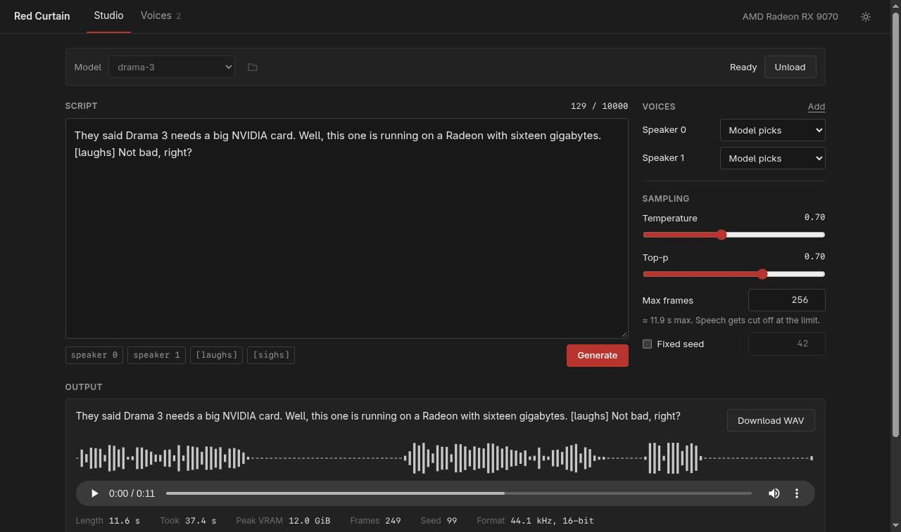

# Red Curtain

Run [Fish Audio Drama 3](https://huggingface.co/fishaudio/drama-3) locally on an AMD GPU.

Officially Drama 3 needs an NVIDIA card with at least 48 GB of VRAM. ROCm isn't supported. I have an RX 9070 with 16 GB and wanted to use it anyway, so here we are. It runs the original FP8 model, not a cut-down version.

The trick is that the model is a 35B MoE, but only about 3B parameters are active per token. So the experts (around 32 GB) stay in system RAM, and only the ones that are needed get moved to the GPU. Everything else fits in VRAM.



**Built with Fish Audio.** This is a community project and has nothing to do with Fish Audio officially.

## What you need

- Linux with a working ROCm PyTorch install (`torch.version.hip` set, GPU visible)
- An AMD GPU with about 12 GB of free VRAM or more
- Lots of RAM. The process uses around 35 GB, so 64 GB is probably the minimum. I have 128 GB.
- About 42 GB of disk for the model
- Node.js + npm for building the UI
- Python 3.11+

**Tested only on an RX 9070 (gfx1201)** with ROCm 7.2 and PyTorch 2.14. Other RDNA3/RDNA4 cards should work as long as ROCm supports them and there's enough VRAM, but I couldn't test them. If you try it on another card, please open an issue and tell me how it went.

## Setup

```bash
git clone https://github.com/re133/red-curtain
cd red-curtain
./setup.sh
./start.sh
```

`setup.sh` creates a `.venv` that reuses your system PyTorch (it never installs torch, drivers or anything system-wide), installs the Python deps and builds the UI.

Then open http://127.0.0.1:7860.

### Getting the model

The weights are not in this repo. Either click **Settings → Download Drama 3** in the UI or run:

```bash
.venv/bin/python scripts/download_model.py --plan
.venv/bin/python scripts/download_model.py --confirm-download
```

That pulls about 41.5 GB from Hugging Face into `models/drama-3`. Downloading means you accept the [Fish Audio Community License](https://huggingface.co/fishaudio/drama-3/blob/main/LICENSE). INT4 doesn't work here, because it depends on NVIDIA's GPTQ-Marlin kernels.

After that everything runs offline.

## Using it

Load the model (takes ~17 seconds), write some text, hit Generate.

Multiple speakers and emotions work the same way as in the original:

```text
<|speaker:0|> Did you hear that?
<|speaker:1|> [sighs] It's just the GPU fans again.
```

You can also add reference voices (WAV or FLAC, up to 15 seconds, with an exact transcript) and assign them to speaker 0 or 1. **Only use recordings of people who agreed to it.** The Fish license is very clear about that, see below.

There's also a CLI:

```bash
.venv/bin/python generate.py \
  --model models/drama-3 \
  --text "Hello from an AMD card." \
  --output outputs/hello.wav
```

Add `--reference-audio ref.wav --reference-text "exact transcript"` for voice cloning.

## How fast is it

Honestly, not realtime. On my RX 9070 + Ryzen 9 5900XT + 128 GB DDR4:

| | |
|---|---|
| Model load | ~17 s |
| 3.3 s of speech | ~13 s |
| 11.6 s of speech | ~37 s |
| VRAM peak | ~11–12 GB |
| Process RAM | ~35 GB |

Most of the time goes into moving experts over PCIe. A GPU with more VRAM can keep more experts cached, which makes it faster.

## How it works

- The dense layers and the audio decoder load to the GPU in BF16
- The FP8 MoE experts stay compressed in RAM. Per token, only the experts the router picks get dequantized and moved to the GPU. A shared LRU cache keeps the hot ones there.
- The NVIDIA FP8 GEMMs are replaced by plain FP8 dequant + PyTorch matmul, which works on ROCm
- Before the DAC decodes the audio, the backbone weights get parked in RAM. This frees VRAM for the decoder's big conv buffers and gets moved back for the next take.
- The VRAM budget is picked automatically from what's free on your card, with some headroom left for the desktop
- GPU temperature is watched (read-only), and a job stops if the card gets too hot

The model code itself is Fish Audio's code from [fish-speech](https://github.com/fishaudio/fish-speech), basically unchanged. The DAC codec comes from [vLLM-Omni](https://github.com/vllm-project/vllm-omni).

## Known issues

- One generation is about 47 seconds of audio max (1024 frames). There's no automatic splitting of long texts yet.
- Sometimes a take ends in a long silence or gets cut off. Just try a different seed; the UI warns you when it detects this.
- `MIOPEN_FIND_MODE=FAST` is set by `start.sh`. Without it, MIOpen searches kernels for ages every time the audio length changes.
- Only one job runs at a time

## Tests

```bash
.venv/bin/python -m pytest -q
./start.sh --probe        # checks the GPU ops the model needs
```

## License

My own code is MIT. But this repo also contains code from Fish Audio, so not everything is MIT:

- `red_curtain/fish_omni/`, `errors.py`, `sampling.py`: **Fish Audio Community License v1.0**
- `red_curtain/codec/`: Apache-2.0 (with MIT parts from Descript)
- The Drama 3 weights (not included) are also under the Fish Audio Community License

Details are in [LICENSE](LICENSE) and [NOTICE](NOTICE).

Short version of what the Fish license means for you: personal use, research and testing are free. Commercial use is OK as long as your company makes less than USD 500k a year. Running it as a hosted TTS service for other people needs a separate license from Fish Audio.

And these rules apply to everyone who uses it (section IV(b) of the license):

- don't clone the voice of a real person without their consent
- don't impersonate people to deceive, scam or harass anyone
- no sexual content involving minors, and no real person's voice without consent
- don't remove watermarks
- don't use the output to train other speech models

## Credits

- [Fish Audio](https://fish.audio) for Drama 3 and fish-speech
- [vLLM-Omni](https://github.com/vllm-project/vllm-omni) for the standalone DAC code
- Built by me with Claude
